<p><picture>
  <source media="(prefers-color-scheme: dark)" srcset="imagenes/readme/portada-oscuro.svg">
  
</picture></p>

<p align="center">
  <a href="https://academy.langchain.com/courses/intro-to-langgraph"></a>
  
  
  
  
  <a href="langchain-academy/LICENSE"></a>
</p>

Mis apuntes del curso [Introduction to LangGraph](https://academy.langchain.com/courses/intro-to-langgraph) de LangChain Academy, con todos sus notebooks. Son siete módulos y unas seis horas de video: se parte con un grafo de tres nodos y se termina con un agente con memoria a largo plazo, desplegado como una API.

El código es el del repositorio oficial [langchain-academy](https://github.com/langchain-ai/langchain-academy), con licencia MIT, y está en la carpeta [`langchain-academy`](langchain-academy). Los videos se ven en la página del curso, que es gratis con una cuenta de LangChain Academy.

## Mi versión del curso

Estoy reescribiendo el curso con mi visión: los mismos temas, cada concepto con su definición formal, sus propiedades y el código que lo implementa, con ejemplos matemáticos. Va en [`modulos`](modulos), lección por lección.

- Módulo 1 · [Grafo sin modelo](modulos/modulo-1/01_grafo_sin_modelo.ipynb): el método de Newton como grafo de LangGraph. [Índice del módulo](modulos/modulo-1).

## La ruta

<p><picture>
  <source media="(prefers-color-scheme: dark)" srcset="imagenes/readme/ruta-oscuro.svg">
  
</picture></p>

Cada módulo usa lo del anterior. El 1 arma un agente que decide cuándo usar una herramienta, el 2 controla qué guarda en su estado, el 3 lo hace detenerse para pedir permiso, el 4 lo convierte en un asistente que investiga en paralelo, el 5 le da memoria entre conversaciones y el 6 lo sirve como una API.

## LangGraph en un grafo

Un grafo de LangGraph tiene tres piezas: un **estado** que comparten todos los nodos, **nodos** que son funciones que reciben el estado y devuelven qué cambiar, y **aristas** que dicen qué nodo sigue, fijas o condicionales. Este es el grafo de la primera lección práctica, el mismo que se ve animado en la tarjeta del módulo 1:

```python
import random
from typing import Literal

from typing_extensions import TypedDict
from langgraph.graph import StateGraph, START, END


class State(TypedDict):
    graph_state: str


def node_1(state):
    return {"graph_state": state["graph_state"] + " I am"}

def node_2(state):
    return {"graph_state": state["graph_state"] + " happy!"}

def node_3(state):
    return {"graph_state": state["graph_state"] + " sad!"}

def decide_mood(state) -> Literal["node_2", "node_3"]:
    return "node_2" if random.random() < 0.5 else "node_3"


builder = StateGraph(State)
builder.add_node("node_1", node_1)
builder.add_node("node_2", node_2)
builder.add_node("node_3", node_3)
builder.add_edge(START, "node_1")
builder.add_conditional_edges("node_1", decide_mood)
builder.add_edge("node_2", END)
builder.add_edge("node_3", END)
graph = builder.compile()

graph.invoke({"graph_state": "Hi, this is Lance."})
# {'graph_state': 'Hi, this is Lance. I am happy!'}, o "sad!", al azar
```

`decide_mood` es la arista condicional: mira el estado y devuelve el nombre del nodo que sigue. Aquí elige al azar. En el agente del módulo 1 la misma idea decide si el modelo pidió una herramienta: si la pidió, sigue `tools`; si no, termina.

Solo necesita `pip install langgraph`, sin claves.

## Mis apuntes

En [`apuntes/`](apuntes) van mis notebooks en español, uno por lección. Explican cada pieza paso a paso, prueban lo que pasa cuando algo se hace mal y terminan con ejercicios. Usan un modelo local con Ollama (`qwen2.5:7b`), así que corren gratis y sin claves, y cada uno trae una celda para cambiarlo por `gpt-4o`.

| Módulo | Apuntes |
|---|---|
| 1 · Introducción | [5 notebooks](apuntes/modulo-1): el grafo más simple, mensajes y cadena, router, agente y agente con memoria |

## Contenido

Los números de la tabla son los de cada lección en el curso. Los enlaces de video piden iniciar sesión en LangChain Academy. Cada notebook se puede leer en GitHub, la mayoría con sus salidas a la vista, o abrir en Colab para ejecutarlo. La columna Studio enlaza el mismo grafo como archivo `.py`, listo para [LangSmith Studio](#langsmith-studio).

### Módulo 0 · Puesta a punto

Cómo instalar el entorno, configurar las claves y hacer la primera llamada a un modelo de chat.

| | Lección | Video | Notebook | Studio |
|---|---|---|---|---|
|  | Presentación del curso | [3&nbsp;min](https://academy.langchain.com/courses/take/intro-to-langgraph/lessons/58238107-course-overview) |  |  |
|  | Puesta a punto | [14&nbsp;min](https://academy.langchain.com/courses/take/intro-to-langgraph/lessons/69748093-getting-set-up-video-guide) | [`basics.ipynb`](langchain-academy/module-0/basics.ipynb) <a href="https://colab.research.google.com/github/B3njjaman/LangGraph/blob/main/langchain-academy/module-0/basics.ipynb"></a> |  |

### Módulo 1 · Introducción

<p><picture>
  <source media="(prefers-color-scheme: dark)" srcset="imagenes/readme/modulo-1-oscuro.svg">
  
</picture></p>

Mis apuntes de este módulo: [`apuntes/modulo-1`](apuntes/modulo-1).

| | Lección | Video | Notebook | Studio |
|---|---|---|---|---|
|  | Presentación del módulo | [1&nbsp;min](https://academy.langchain.com/courses/take/intro-to-langgraph/lessons/58239409-module-1-introduction) |  |  |
| 1 | Motivación | [8&nbsp;min](https://academy.langchain.com/courses/take/intro-to-langgraph/lessons/57712261-lesson-1-motivation) |  |  |
| 2 | El grafo más simple | [6&nbsp;min](https://academy.langchain.com/courses/take/intro-to-langgraph/lessons/58238187-lesson-2-simple-graph) | [`simple-graph.ipynb`](langchain-academy/module-1/simple-graph.ipynb) <a href="https://colab.research.google.com/github/B3njjaman/LangGraph/blob/main/langchain-academy/module-1/simple-graph.ipynb"></a> | [`simple.py`](langchain-academy/module-1/studio/simple.py) |
| 3 | LangSmith Studio | [3&nbsp;min](https://academy.langchain.com/courses/take/intro-to-langgraph/lessons/58238461-lesson-3-langsmith-studio) |  | [`studio/`](langchain-academy/module-1/studio) |
| 4 | Cadena | [6&nbsp;min](https://academy.langchain.com/courses/take/intro-to-langgraph/lessons/58238466-lesson-4-chain) | [`chain.ipynb`](langchain-academy/module-1/chain.ipynb) <a href="https://colab.research.google.com/github/B3njjaman/LangGraph/blob/main/langchain-academy/module-1/chain.ipynb"></a> |  |
| 5 | Router | [5&nbsp;min](https://academy.langchain.com/courses/take/intro-to-langgraph/lessons/58239412-lesson-5-router) | [`router.ipynb`](langchain-academy/module-1/router.ipynb) <a href="https://colab.research.google.com/github/B3njjaman/LangGraph/blob/main/langchain-academy/module-1/router.ipynb"></a> | [`router.py`](langchain-academy/module-1/studio/router.py) |
| 6 | Agente | [8&nbsp;min](https://academy.langchain.com/courses/take/intro-to-langgraph/lessons/58239232-lesson-6-agent) | [`agent.ipynb`](langchain-academy/module-1/agent.ipynb) <a href="https://colab.research.google.com/github/B3njjaman/LangGraph/blob/main/langchain-academy/module-1/agent.ipynb"></a> | [`agent.py`](langchain-academy/module-1/studio/agent.py) |
| 7 | Agente con memoria | [8&nbsp;min](https://academy.langchain.com/courses/take/intro-to-langgraph/lessons/58239417-lesson-7-agent-with-memory) | [`agent-memory.ipynb`](langchain-academy/module-1/agent-memory.ipynb) <a href="https://colab.research.google.com/github/B3njjaman/LangGraph/blob/main/langchain-academy/module-1/agent-memory.ipynb"></a> |  |
| 8 | Introducción al despliegue (opcional) | [6&nbsp;min](https://academy.langchain.com/courses/take/intro-to-langgraph/lessons/58239303-optional-lesson-8-intro-to-deployment) | [`deployment.ipynb`](langchain-academy/module-1/deployment.ipynb) <a href="https://colab.research.google.com/github/B3njjaman/LangGraph/blob/main/langchain-academy/module-1/deployment.ipynb"></a> |  |

<details>
<summary>Diagramas del curso</summary>
<br>
<table>
  <tr>
    <td width="50%" valign="top">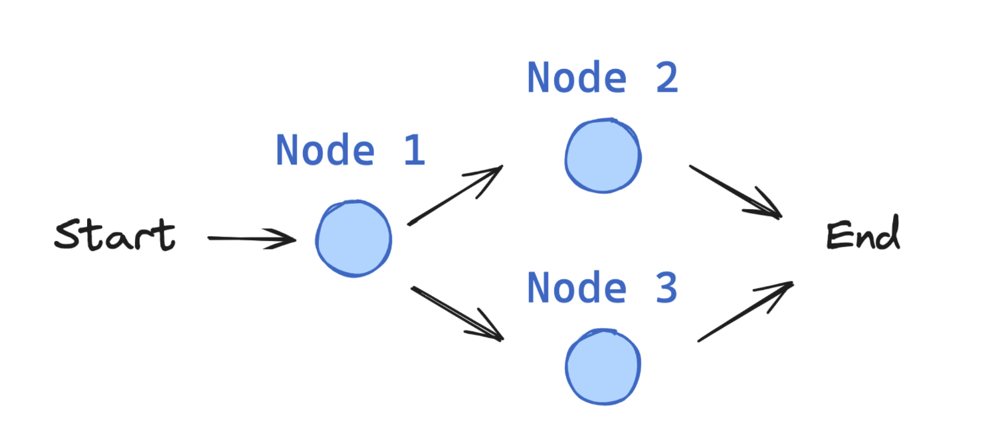<br><sub>El grafo más simple</sub></td>
    <td width="50%" valign="top">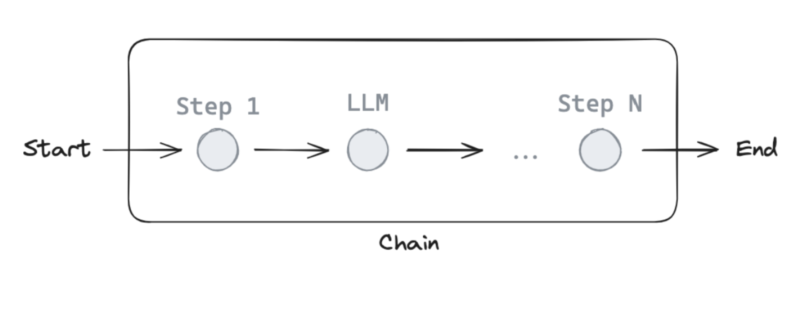<br><sub>Cadena</sub></td>
  </tr>
  <tr>
    <td width="50%" valign="top">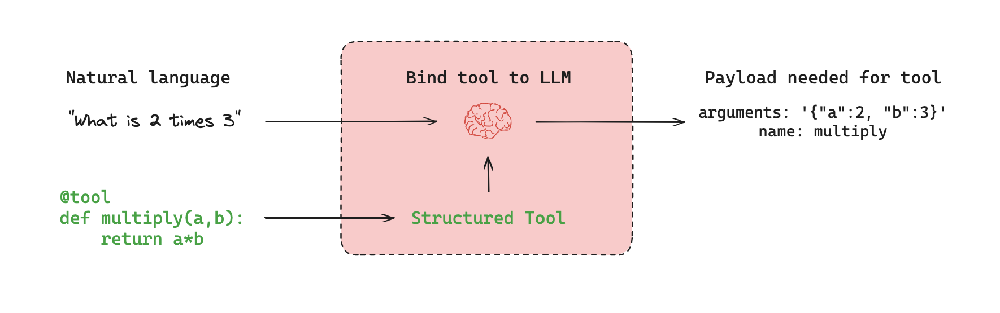<br><sub>Cadena</sub></td>
    <td width="50%" valign="top">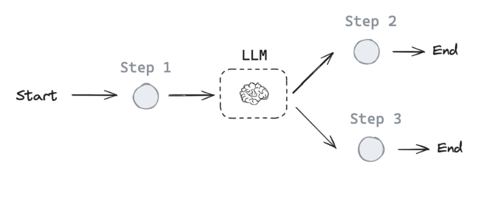<br><sub>Router</sub></td>
  </tr>
  <tr>
    <td width="50%" valign="top">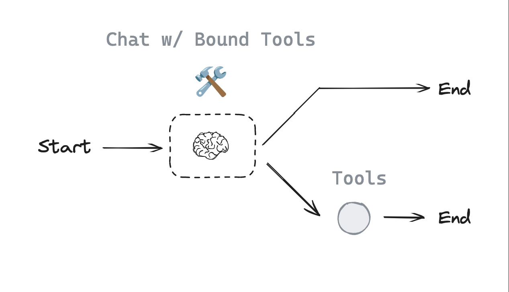<br><sub>Agente</sub></td>
    <td width="50%" valign="top">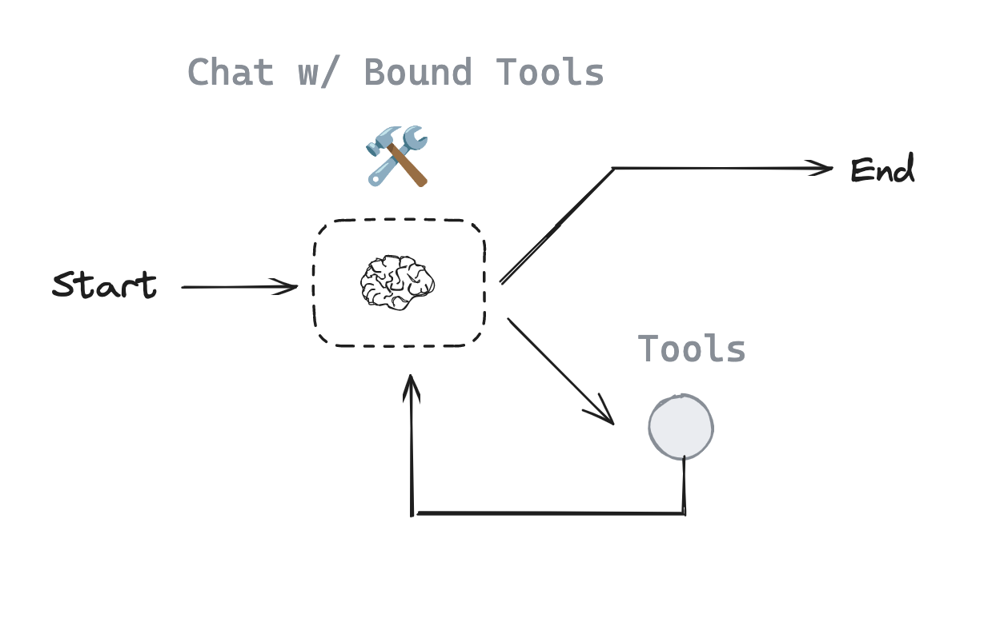<br><sub>Agente con memoria</sub></td>
  </tr>
  <tr>
    <td width="50%" valign="top">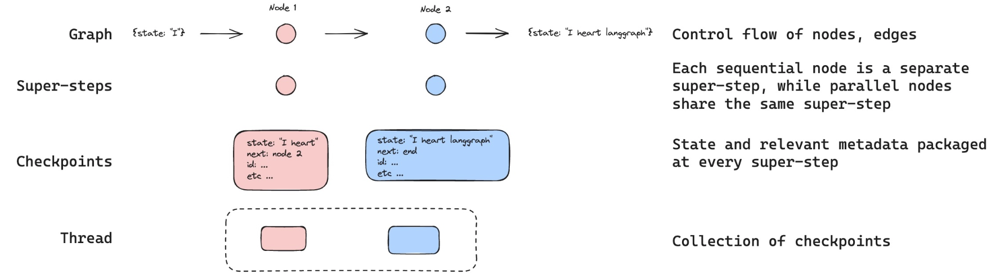<br><sub>Agente con memoria</sub></td>
    <td width="50%" valign="top">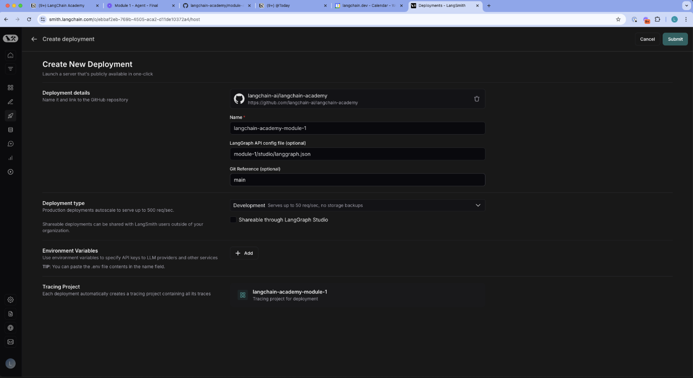<br><sub>Introducción al despliegue</sub></td>
  </tr>
  <tr>
    <td width="50%" valign="top">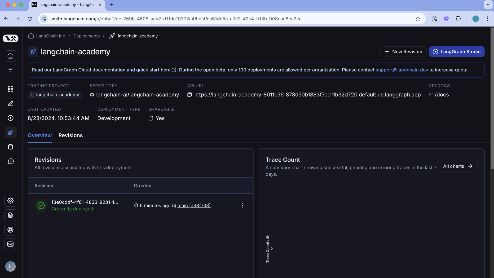<br><sub>Introducción al despliegue</sub></td>
    <td width="50%" valign="top"></td>
  </tr>
</table>
</details>

### Módulo 2 · Estado y memoria

<p><picture>
  <source media="(prefers-color-scheme: dark)" srcset="imagenes/readme/modulo-2-oscuro.svg">
  
</picture></p>

| | Lección | Video | Notebook | Studio |
|---|---|---|---|---|
|  | Presentación del módulo | [1&nbsp;min](https://academy.langchain.com/courses/take/intro-to-langgraph/lessons/58239430-module-2-introduction) |  |  |
| 1 | Esquema del estado | [4&nbsp;min](https://academy.langchain.com/courses/take/intro-to-langgraph/lessons/58239426-lesson-1-state-schema) | [`state-schema.ipynb`](langchain-academy/module-2/state-schema.ipynb) <a href="https://colab.research.google.com/github/B3njjaman/LangGraph/blob/main/langchain-academy/module-2/state-schema.ipynb"></a> |  |
| 2 | Reducers | [10&nbsp;min](https://academy.langchain.com/courses/take/intro-to-langgraph/lessons/58239428-lesson-2-state-reducers) | [`state-reducers.ipynb`](langchain-academy/module-2/state-reducers.ipynb) <a href="https://colab.research.google.com/github/B3njjaman/LangGraph/blob/main/langchain-academy/module-2/state-reducers.ipynb"></a> |  |
| 3 | Varios esquemas | [5&nbsp;min](https://academy.langchain.com/courses/take/intro-to-langgraph/lessons/58239434-lesson-3-multiple-schemas) | [`multiple-schemas.ipynb`](langchain-academy/module-2/multiple-schemas.ipynb) <a href="https://colab.research.google.com/github/B3njjaman/LangGraph/blob/main/langchain-academy/module-2/multiple-schemas.ipynb"></a> |  |
| 4 | Recortar y filtrar mensajes | [8&nbsp;min](https://academy.langchain.com/courses/take/intro-to-langgraph/lessons/58239435-lesson-4-trim-and-filter-messages) | [`trim-filter-messages.ipynb`](langchain-academy/module-2/trim-filter-messages.ipynb) <a href="https://colab.research.google.com/github/B3njjaman/LangGraph/blob/main/langchain-academy/module-2/trim-filter-messages.ipynb"></a> |  |
| 5 | Chatbot que resume la conversación | [9&nbsp;min](https://academy.langchain.com/courses/take/intro-to-langgraph/lessons/58239436-lesson-5-chatbot-w-summarizing-messages-and-memory) | [`chatbot-summarization.ipynb`](langchain-academy/module-2/chatbot-summarization.ipynb) <a href="https://colab.research.google.com/github/B3njjaman/LangGraph/blob/main/langchain-academy/module-2/chatbot-summarization.ipynb"></a> | [`chatbot.py`](langchain-academy/module-2/studio/chatbot.py) |
| 6 | Chatbot con memoria externa (SQLite) | [8&nbsp;min](https://academy.langchain.com/courses/take/intro-to-langgraph/lessons/58239440-lesson-6-chatbot-w-summarizing-messages-and-external-memory) | [`chatbot-external-memory.ipynb`](langchain-academy/module-2/chatbot-external-memory.ipynb) <a href="https://colab.research.google.com/github/B3njjaman/LangGraph/blob/main/langchain-academy/module-2/chatbot-external-memory.ipynb"></a> |  |

<details>
<summary>Diagrama del curso</summary>
<br>
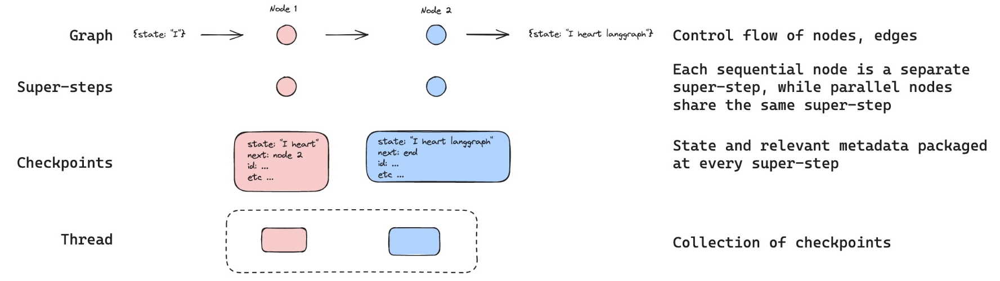<br><sub>Chatbot que resume la conversación</sub>
</details>

### Módulo 3 · Human-in-the-loop

<p><picture>
  <source media="(prefers-color-scheme: dark)" srcset="imagenes/readme/modulo-3-oscuro.svg">
  
</picture></p>

| | Lección | Video | Notebook | Studio |
|---|---|---|---|---|
|  | Presentación del módulo | [1&nbsp;min](https://academy.langchain.com/courses/take/intro-to-langgraph/lessons/58239463-module-3-introduction) |  |  |
| 1 | Streaming | [11&nbsp;min](https://academy.langchain.com/courses/take/intro-to-langgraph/lessons/58239464-lesson-1-streaming) | [`streaming-interruption.ipynb`](langchain-academy/module-3/streaming-interruption.ipynb) <a href="https://colab.research.google.com/github/B3njjaman/LangGraph/blob/main/langchain-academy/module-3/streaming-interruption.ipynb"></a> |  |
| 2 | Breakpoints | [9&nbsp;min](https://academy.langchain.com/courses/take/intro-to-langgraph/lessons/58239469-lesson-2-breakpoints) | [`breakpoints.ipynb`](langchain-academy/module-3/breakpoints.ipynb) <a href="https://colab.research.google.com/github/B3njjaman/LangGraph/blob/main/langchain-academy/module-3/breakpoints.ipynb"></a> | [`agent.py`](langchain-academy/module-3/studio/agent.py) |
| 3 | Editar el estado y feedback humano | [11&nbsp;min](https://academy.langchain.com/courses/take/intro-to-langgraph/lessons/58239520-lesson-3-editing-state-and-human-feedback) | [`edit-state-human-feedback.ipynb`](langchain-academy/module-3/edit-state-human-feedback.ipynb) <a href="https://colab.research.google.com/github/B3njjaman/LangGraph/blob/main/langchain-academy/module-3/edit-state-human-feedback.ipynb"></a> |  |
| 4 | Breakpoints dinámicos | [4&nbsp;min](https://academy.langchain.com/courses/take/intro-to-langgraph/lessons/58239526-lesson-4-dynamic-breakpoints) | [`dynamic-breakpoints.ipynb`](langchain-academy/module-3/dynamic-breakpoints.ipynb) <a href="https://colab.research.google.com/github/B3njjaman/LangGraph/blob/main/langchain-academy/module-3/dynamic-breakpoints.ipynb"></a> | [`dynamic_breakpoints.py`](langchain-academy/module-3/studio/dynamic_breakpoints.py) |
| 5 | Time travel | [19&nbsp;min](https://academy.langchain.com/courses/take/intro-to-langgraph/lessons/58239536-lesson-5-time-travel) | [`time-travel.ipynb`](langchain-academy/module-3/time-travel.ipynb) <a href="https://colab.research.google.com/github/B3njjaman/LangGraph/blob/main/langchain-academy/module-3/time-travel.ipynb"></a> |  |

<details>
<summary>Diagramas del curso</summary>
<br>
<table>
  <tr>
    <td width="50%" valign="top">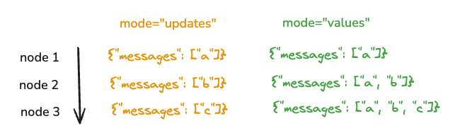<br><sub>Streaming</sub></td>
    <td width="50%" valign="top">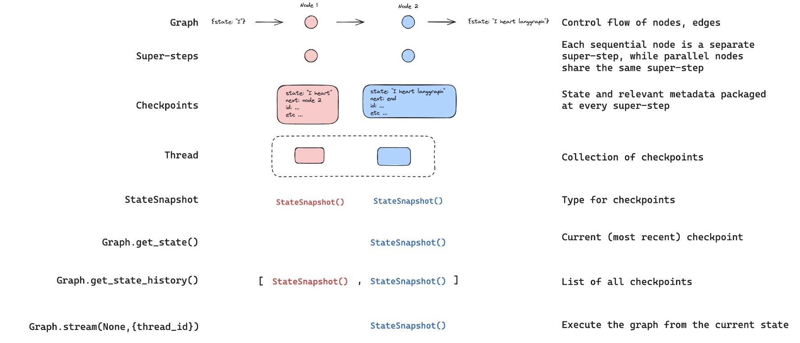<br><sub>Breakpoints</sub></td>
  </tr>
  <tr>
    <td width="50%" valign="top">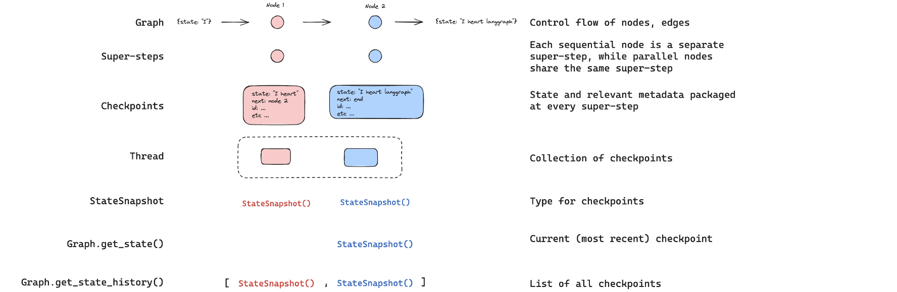<br><sub>Time travel</sub></td>
    <td width="50%" valign="top">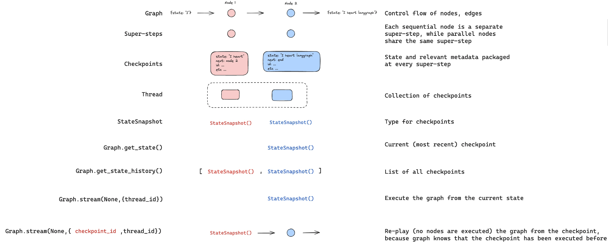<br><sub>Time travel</sub></td>
  </tr>
  <tr>
    <td width="50%" valign="top">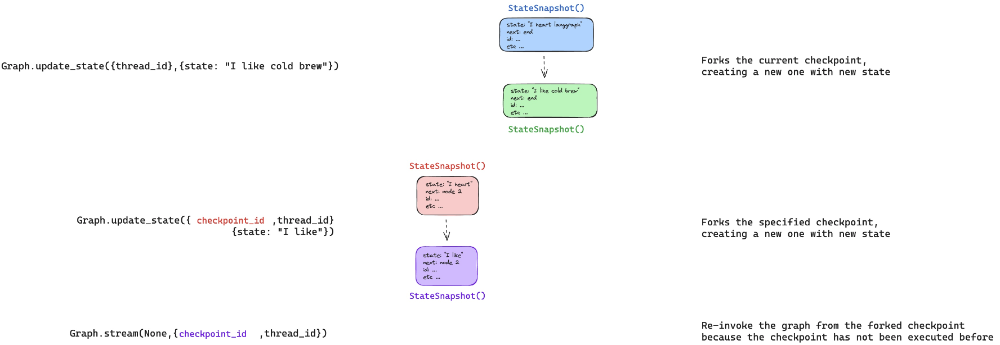<br><sub>Time travel</sub></td>
    <td width="50%" valign="top"></td>
  </tr>
</table>
</details>

### Módulo 4 · Tu asistente

<p><picture>
  <source media="(prefers-color-scheme: dark)" srcset="imagenes/readme/modulo-4-oscuro.svg">
  
</picture></p>

| | Lección | Video | Notebook | Studio |
|---|---|---|---|---|
|  | Presentación del módulo | [2&nbsp;min](https://academy.langchain.com/courses/take/intro-to-langgraph/lessons/58239986-module-4-introduction) |  |  |
| 1 | Nodos en paralelo | [11&nbsp;min](https://academy.langchain.com/courses/take/intro-to-langgraph/lessons/58239934-lesson-1-parallelization) | [`parallelization.ipynb`](langchain-academy/module-4/parallelization.ipynb) <a href="https://colab.research.google.com/github/B3njjaman/LangGraph/blob/main/langchain-academy/module-4/parallelization.ipynb"></a> | [`parallelization.py`](langchain-academy/module-4/studio/parallelization.py) |
| 2 | Sub-grafos | [8&nbsp;min](https://academy.langchain.com/courses/take/intro-to-langgraph/lessons/58239937-lesson-2-sub-graphs) | [`sub-graph.ipynb`](langchain-academy/module-4/sub-graph.ipynb) <a href="https://colab.research.google.com/github/B3njjaman/LangGraph/blob/main/langchain-academy/module-4/sub-graph.ipynb"></a> | [`sub_graphs.py`](langchain-academy/module-4/studio/sub_graphs.py) |
| 3 | Map-reduce | [13&nbsp;min](https://academy.langchain.com/courses/take/intro-to-langgraph/lessons/58239947-lesson-3-map-reduce) | [`map-reduce.ipynb`](langchain-academy/module-4/map-reduce.ipynb) <a href="https://colab.research.google.com/github/B3njjaman/LangGraph/blob/main/langchain-academy/module-4/map-reduce.ipynb"></a> | [`map_reduce.py`](langchain-academy/module-4/studio/map_reduce.py) |
| 4 | Asistente de investigación | [27&nbsp;min](https://academy.langchain.com/courses/take/intro-to-langgraph/lessons/58239974-lesson-4-research-assistant) | [`research-assistant.ipynb`](langchain-academy/module-4/research-assistant.ipynb) <a href="https://colab.research.google.com/github/B3njjaman/LangGraph/blob/main/langchain-academy/module-4/research-assistant.ipynb"></a> | [`research_assistant.py`](langchain-academy/module-4/studio/research_assistant.py) |

<details>
<summary>Diagramas del curso</summary>
<br>
<table>
  <tr>
    <td width="50%" valign="top">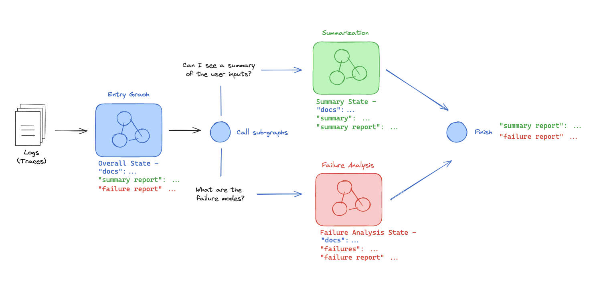<br><sub>Sub-grafos</sub></td>
    <td width="50%" valign="top">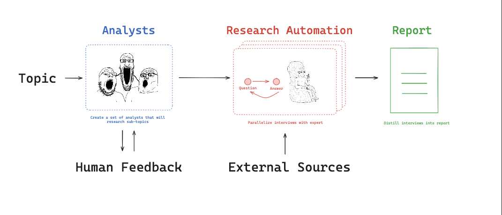<br><sub>Asistente de investigación</sub></td>
  </tr>
</table>
</details>

### Módulo 5 · Memoria a largo plazo

<p><picture>
  <source media="(prefers-color-scheme: dark)" srcset="imagenes/readme/modulo-5-oscuro.svg">
  
</picture></p>

| | Lección | Video | Notebook | Studio |
|---|---|---|---|---|
| 1 | Memoria de corto y largo plazo | [13&nbsp;min](https://academy.langchain.com/courses/take/intro-to-langgraph/lessons/59970887-lesson-1-short-vs-long-term-memory) |  |  |
| 2 | El Store de LangGraph | [11&nbsp;min](https://academy.langchain.com/courses/take/intro-to-langgraph/lessons/59970899-lesson-2-langgraph-store) | [`memory_store.ipynb`](langchain-academy/module-5/memory_store.ipynb) <a href="https://colab.research.google.com/github/B3njjaman/LangGraph/blob/main/langchain-academy/module-5/memory_store.ipynb"></a> | [`memory_store.py`](langchain-academy/module-5/studio/memory_store.py) |
| 3 | Esquema de memoria: perfil | [18&nbsp;min](https://academy.langchain.com/courses/take/intro-to-langgraph/lessons/59970910-lesson-3-memory-schema-profile) | [`memoryschema_profile.ipynb`](langchain-academy/module-5/memoryschema_profile.ipynb) <a href="https://colab.research.google.com/github/B3njjaman/LangGraph/blob/main/langchain-academy/module-5/memoryschema_profile.ipynb"></a> | [`memoryschema_profile.py`](langchain-academy/module-5/studio/memoryschema_profile.py) |
| 4 | Esquema de memoria: colección | [13&nbsp;min](https://academy.langchain.com/courses/take/intro-to-langgraph/lessons/59971006-lesson-4-memory-schema-collection) | [`memoryschema_collection.ipynb`](langchain-academy/module-5/memoryschema_collection.ipynb) <a href="https://colab.research.google.com/github/B3njjaman/LangGraph/blob/main/langchain-academy/module-5/memoryschema_collection.ipynb"></a> | [`memoryschema_collection.py`](langchain-academy/module-5/studio/memoryschema_collection.py) |
| 5 | Un agente con memoria a largo plazo | [23&nbsp;min](https://academy.langchain.com/courses/take/intro-to-langgraph/lessons/59971030-lesson-5-build-an-agent-with-long-term-memory) | [`memory_agent.ipynb`](langchain-academy/module-5/memory_agent.ipynb) <a href="https://colab.research.google.com/github/B3njjaman/LangGraph/blob/main/langchain-academy/module-5/memory_agent.ipynb"></a> | [`memory_agent.py`](langchain-academy/module-5/studio/memory_agent.py) |

<details>
<summary>Diagramas y capturas del curso</summary>
<br>
<table>
  <tr>
    <td width="50%" valign="top">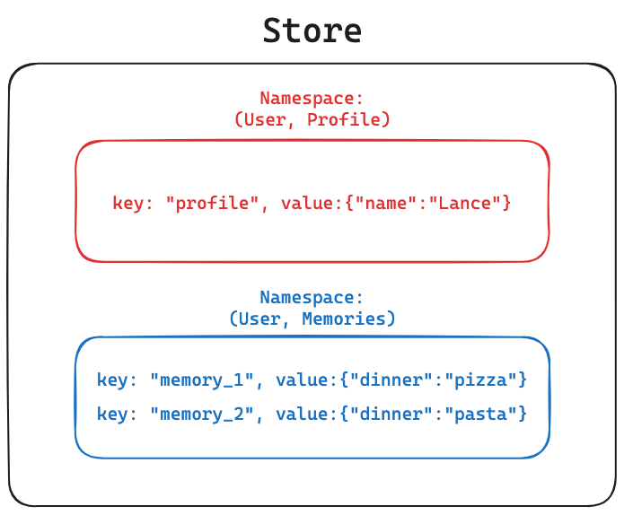<br><sub>El Store de LangGraph</sub></td>
    <td width="50%" valign="top">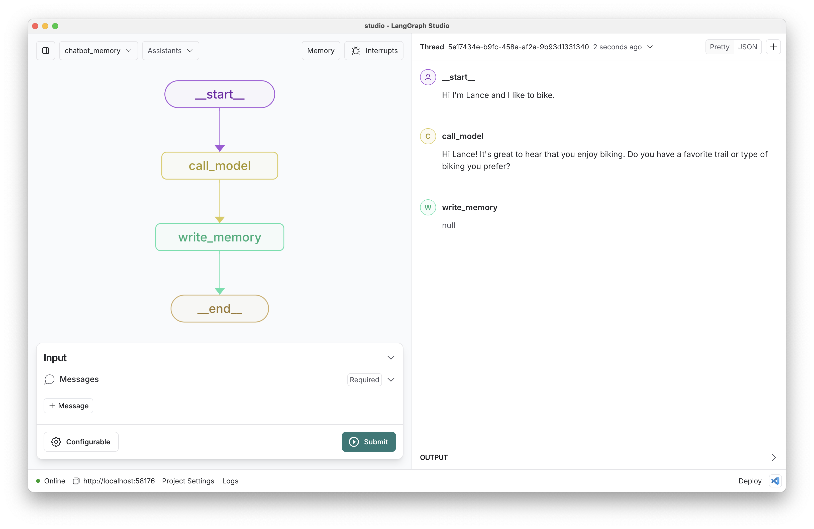<br><sub>El Store de LangGraph</sub></td>
  </tr>
  <tr>
    <td width="50%" valign="top">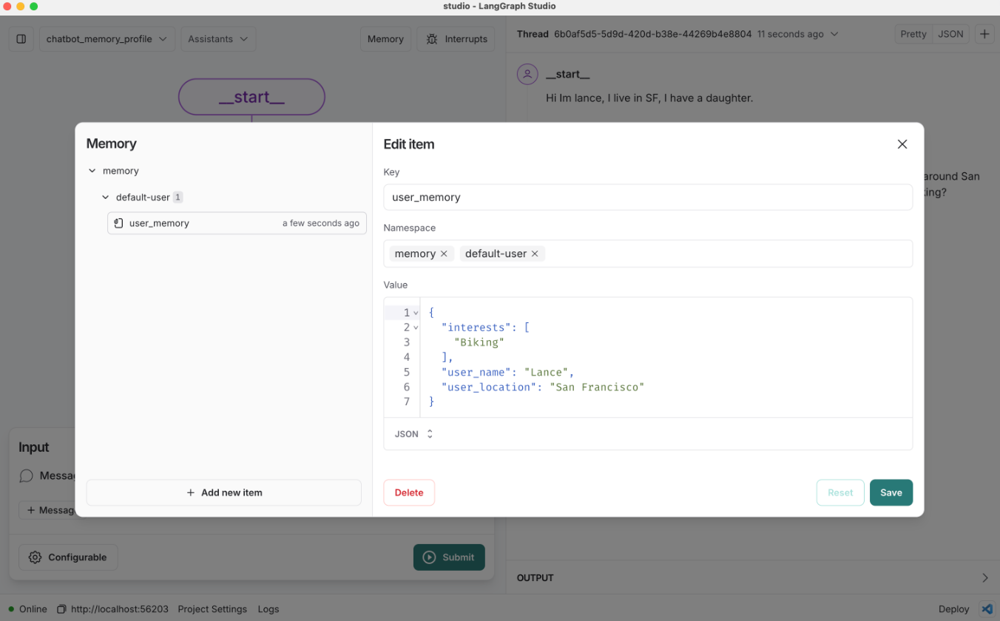<br><sub>Esquema de memoria: perfil</sub></td>
    <td width="50%" valign="top">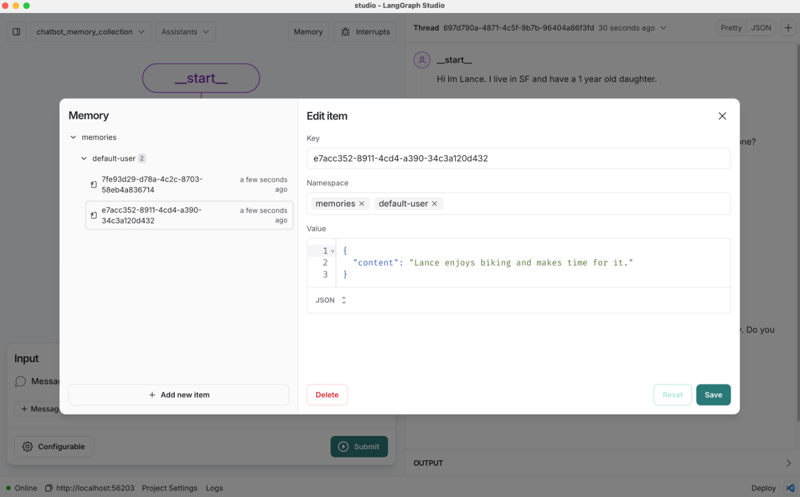<br><sub>Esquema de memoria: colección</sub></td>
  </tr>
  <tr>
    <td width="50%" valign="top">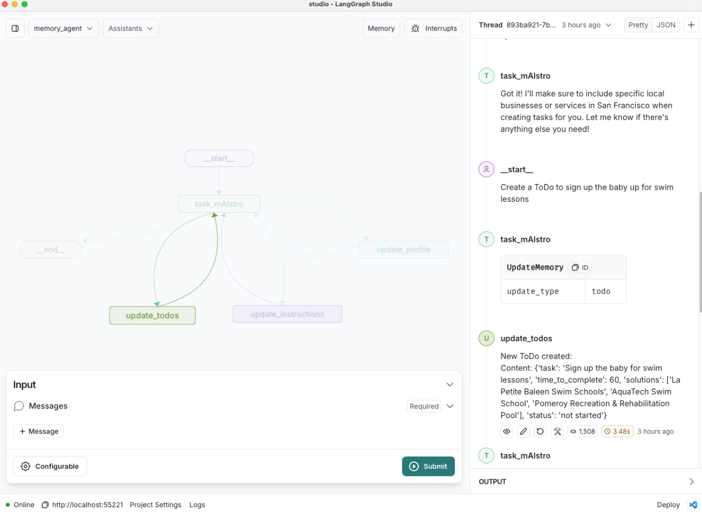<br><sub>Un agente con memoria a largo plazo</sub></td>
    <td width="50%" valign="top"></td>
  </tr>
</table>
</details>

### Módulo 6 · Despliegue

<p><picture>
  <source media="(prefers-color-scheme: dark)" srcset="imagenes/readme/modulo-6-oscuro.svg">
  
</picture></p>

| | Lección | Video | Notebook | Studio |
|---|---|---|---|---|
| 1 | Conceptos de despliegue | [7&nbsp;min](https://academy.langchain.com/courses/take/intro-to-langgraph/lessons/60143576-lesson-1-deployment-concepts) |  |  |
| 2 | Crear un despliegue | [6&nbsp;min](https://academy.langchain.com/courses/take/intro-to-langgraph/lessons/60143578-lesson-2-creating-a-deployment) | [`creating.ipynb`](langchain-academy/module-6/creating.ipynb) <a href="https://colab.research.google.com/github/B3njjaman/LangGraph/blob/main/langchain-academy/module-6/creating.ipynb"></a> | [`deployment/`](langchain-academy/module-6/deployment) |
| 3 | Conectarse a un despliegue | [20&nbsp;min](https://academy.langchain.com/courses/take/intro-to-langgraph/lessons/60143580-lesson-3-connecting-to-a-deployment) | [`connecting.ipynb`](langchain-academy/module-6/connecting.ipynb) <a href="https://colab.research.google.com/github/B3njjaman/LangGraph/blob/main/langchain-academy/module-6/connecting.ipynb"></a> |  |
| 4 | Double texting | [7&nbsp;min](https://academy.langchain.com/courses/take/intro-to-langgraph/lessons/60143582-lesson-4-double-texting) | [`double-texting.ipynb`](langchain-academy/module-6/double-texting.ipynb) <a href="https://colab.research.google.com/github/B3njjaman/LangGraph/blob/main/langchain-academy/module-6/double-texting.ipynb"></a> |  |
| 5 | Assistants | [9&nbsp;min](https://academy.langchain.com/courses/take/intro-to-langgraph/lessons/60143583-lesson-5-assistants) | [`assistant.ipynb`](langchain-academy/module-6/assistant.ipynb) <a href="https://colab.research.google.com/github/B3njjaman/LangGraph/blob/main/langchain-academy/module-6/assistant.ipynb"></a> |  |

<details>
<summary>Diagramas y capturas del curso</summary>
<br>
<table>
  <tr>
    <td width="50%" valign="top">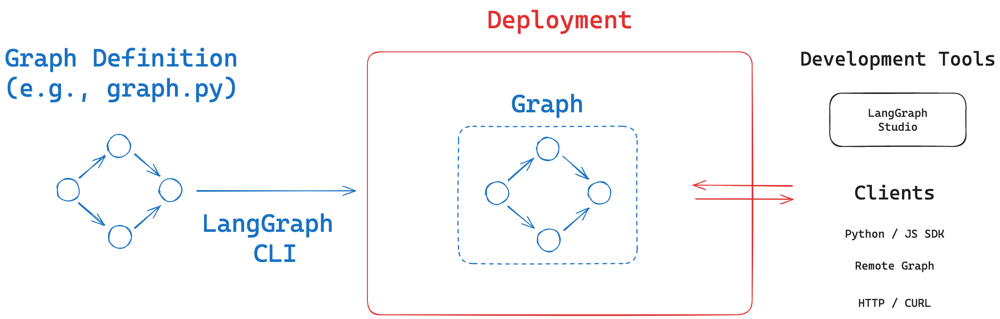<br><sub>Conectarse a un despliegue</sub></td>
    <td width="50%" valign="top">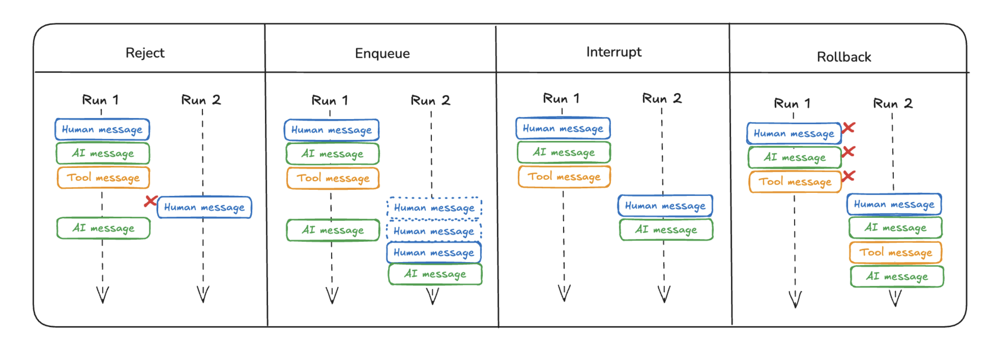<br><sub>Double texting</sub></td>
  </tr>
  <tr>
    <td width="50%" valign="top">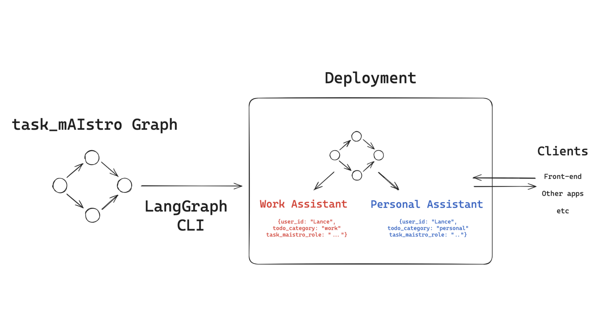<br><sub>Assistants</sub></td>
    <td width="50%" valign="top"></td>
  </tr>
</table>
</details>

## Cómo ejecutarlos

**En tu computador**, con Python 3.11, 3.12 o 3.13.

En Windows (PowerShell):

```powershell
git clone https://github.com/B3njjaman/LangGraph.git
cd LangGraph\langchain-academy
python -m venv .venv
Set-ExecutionPolicy -ExecutionPolicy RemoteSigned -Scope Process
.\.venv\Scripts\Activate.ps1
pip install -r requirements.txt
jupyter notebook
```

En macOS o Linux:

```bash
git clone https://github.com/B3njjaman/LangGraph.git
cd LangGraph/langchain-academy
python3 -m venv .venv
source .venv/bin/activate
pip install -r requirements.txt
jupyter notebook
```

**En Google Colab**, con el botón de cada notebook en las tablas. La primera celda de cada uno instala lo que necesita.

### Claves

Si una clave no está como variable de entorno, el notebook la pide al ejecutarse.

| Variable | Para qué sirve | Dónde se usa |
|---|---|---|
| `OPENAI_API_KEY` | El modelo de chat, `gpt-4o` | Casi todos los notebooks |
| `LANGSMITH_API_KEY` | Ver cada paso del grafo en LangSmith | Los 12 notebooks que activan el trazado |
| `TAVILY_API_KEY` | Búsqueda web | Módulo 4 |

Las claves de LangSmith y Tavily tienen un plan gratuito. La de OpenAI cobra por uso.

### LangSmith Studio

Los grafos de los módulos 1 a 5 también están como archivos `.py` en `module-N/studio/`, y Studio los muestra, ejecuta y deja inspeccionar paso a paso. Con el entorno activado:

```bash
cd langchain-academy/module-1/studio
cp .env.example .env    # en PowerShell: copy .env.example .env
langgraph dev
```

Después de poner la clave de OpenAI en `.env`, se abre en el navegador `https://smith.langchain.com/studio/?baseUrl=http://127.0.0.1:2024`. El módulo 4 necesita además `TAVILY_API_KEY` en su `.env`. El módulo 6 tiene un despliegue con Docker en `module-6/deployment/`.

## Estructura

```
LangGraph/
├── apuntes/                 mis notebooks en español, un módulo por carpeta
├── langchain-academy/       el repositorio oficial del curso (MIT)
│   ├── module-0/ … module-6/   los notebooks de cada módulo
│   └── module-N/studio/        los mismos grafos, listos para Studio
├── imagenes/
│   ├── curso/               los diagramas y capturas de cada notebook
│   └── readme/              las imágenes animadas de este README y su generador
└── README.md
```

Las transcripciones de los videos y las páginas de texto del curso no están en el repositorio, porque son contenido de LangChain Academy. Se leen en la página del curso.

## Créditos

El curso, los notebooks y sus diagramas son de [LangChain Academy](https://academy.langchain.com). El código se publica con licencia MIT ([`langchain-academy/LICENSE`](langchain-academy/LICENSE)). Este repositorio no está afiliado a LangChain.

Las imágenes animadas de este README son propias. Salen de [`imagenes/readme/generar.py`](imagenes/readme/generar.py), que solo usa la biblioteca estándar de Python: `python imagenes/readme/generar.py` las vuelve a crear en versión clara y oscura.
