<p><picture>
  <source media="(prefers-color-scheme: dark)" srcset="imagenes/readme/portada-oscuro.svg">
  
</picture></p>

<p align="center">
  
  
  
  
  
</p>

Mi curso de LangGraph, escrito en lenguaje matemático. Cada concepto se presenta como una definición, sus propiedades y el código que lo implementa, y los ejemplos son de matemática: el primer grafo es el método de Newton y el proyecto del módulo 1 es un agente de cálculo simbólico con SymPy.

Las lecciones sin modelo de lenguaje corren en el PC, sin GPU ni claves. Las que usan modelo corren en Kaggle, con Ollama y `qwen3:8b` en una GPU.

## La ruta

<p><picture>
  <source media="(prefers-color-scheme: dark)" srcset="imagenes/readme/ruta-oscuro.svg">
  
</picture></p>

Cada módulo usa lo del anterior. El 1 va de un grafo sin modelo a un agente que decide cuándo usar SymPy, el 2 controla qué guarda su estado, el 3 lo detiene para pedir permiso, el 4 ejecuta varios nodos en el mismo paso, el 5 le da memoria entre conversaciones y el 6 lo sirve como una API.

## LangGraph en un grafo

Un grafo de LangGraph tiene tres piezas. El **estado** $s$ asigna un valor a cada clave de un esquema. Un **nodo** es una función $\varphi : S \to U$ que recibe el estado y devuelve una actualización parcial $u$, que se aplica como $s \oplus u$. Las **aristas** dicen qué nodo sigue: fijas, o condicionales, $c : S \to V \setminus \lbrace\texttt{START}\rbrace$. Este es el grafo de la primera lección, el mismo que se ve animado en la tarjeta del módulo 1:

```python
from typing_extensions import TypedDict
from langgraph.graph import END, START, StateGraph

EPSILON = 1e-10


class EstadoNewton(TypedDict):
    x: float  # aproximación actual
    n: int  # iteraciones hechas


def paso(s: EstadoNewton) -> dict:
    x = s["x"]
    return {"x": x - (x**2 - 2) / (2 * x), "n": s["n"] + 1}


def continuar(s: EstadoNewton) -> str:
    return "paso" if abs(s["x"] ** 2 - 2) >= EPSILON else END


constructor = StateGraph(EstadoNewton)
constructor.add_node("paso", paso)
constructor.add_edge(START, "paso")
constructor.add_conditional_edges("paso", continuar, ["paso", END])
newton = constructor.compile()

newton.invoke({"x": 1.0, "n": 0})
# {'x': 1.4142135623746899, 'n': 4}
```

`paso` aplica $x_{n+1} = x_n - f(x_n)/f^{\prime}(x_n)$ con $f(x) = x^2 - 2$, y `continuar` es la arista condicional: vuelve a `paso` mientras $\lvert f(x) \rvert \ge \varepsilon$. Cada pasada es un superstep, y en cuatro se llega a $\sqrt 2$. En el agente del módulo 1 la misma idea decide si el modelo pidió una herramienta: si la pidió, sigue `tools`; si no, termina.

Solo necesita `pip install langgraph`, sin claves.

## Módulos

### Módulo 1 · Introducción

<p><picture>
  <source media="(prefers-color-scheme: dark)" srcset="imagenes/readme/modulo-1-oscuro.svg">
  
</picture></p>

| Lección | Qué construye |
|---|---|
| 1 · [Grafo sin modelo](modulos/modulo-1/01_grafo_sin_modelo.ipynb)<br><sub>PC</sub> | El método de Newton como grafo: esquema, estado, nodo, reducer, aristas, supersteps y terminación |
| 2 · [Mensajes y herramientas](modulos/modulo-1/02_mensajes_y_herramientas.ipynb)<br><sub>PC y Kaggle</sub> | Mensajes, `add_messages` como monoide, herramientas de SymPy y el modelo como núcleo de probabilidad |
| 3 · Router<br><sub>próximamente · Kaggle</sub> | El modelo decide una vez: grafo acíclico |
| 4 · Agente<br><sub>próximamente · Kaggle</sub> | El ciclo `tools → modelo` y el límite de supersteps |
| 5 · Agente con memoria<br><sub>próximamente · Kaggle</sub> | El hilo como sucesión de estados |

Índice del módulo, con el mapa de las cinco lecciones: [`modulos/modulo-1`](modulos/modulo-1).

### Módulo 2 · Estado y memoria

<p><picture>
  <source media="(prefers-color-scheme: dark)" srcset="imagenes/readme/modulo-2-oscuro.svg">
  
</picture></p>

Por escribir. Esquemas que validan sus tipos, reducers propios y cómo recortar o resumir una conversación larga.

### Módulo 3 · Human-in-the-loop

<p><picture>
  <source media="(prefers-color-scheme: dark)" srcset="imagenes/readme/modulo-3-oscuro.svg">
  
</picture></p>

Por escribir. Streaming, breakpoints, editar el estado y volver a un checkpoint anterior.

### Módulo 4 · Paralelismo

<p><picture>
  <source media="(prefers-color-scheme: dark)" srcset="imagenes/readme/modulo-4-oscuro.svg">
  
</picture></p>

Por escribir. Varios nodos activos en un mismo superstep, sub-grafos y map-reduce con `Send`.

### Módulo 5 · Memoria a largo plazo

<p><picture>
  <source media="(prefers-color-scheme: dark)" srcset="imagenes/readme/modulo-5-oscuro.svg">
  
</picture></p>

Por escribir. La diferencia entre el checkpoint de un hilo y el Store, que sobrevive entre hilos.

### Módulo 6 · Despliegue

<p><picture>
  <source media="(prefers-color-scheme: dark)" srcset="imagenes/readme/modulo-6-oscuro.svg">
  
</picture></p>

Por escribir. Del notebook a una API: servidor de LangGraph, SDK, double texting y assistants.

## Cómo ejecutarlo

**En el PC**, para las lecciones sin modelo. Desde la raíz del repositorio, en Windows (PowerShell):

```powershell
git clone https://github.com/B3njjaman/LangGraph.git
cd LangGraph
python -m venv .venv
.\.venv\Scripts\Activate.ps1
pip install -r modulos/requirements.txt
jupyter notebook
```

En macOS o Linux:

```bash
git clone https://github.com/B3njjaman/LangGraph.git
cd LangGraph
python3 -m venv .venv
source .venv/bin/activate
pip install -r modulos/requirements.txt
jupyter notebook
```

Jupyter tiene que partir en la raíz: las imágenes están en `imagenes/`, y si se abre directo en un módulo no las puede servir.

**En Kaggle**, para las lecciones con modelo: se importa el notebook desde GitHub, se activan la GPU T4 e internet, y se corre entero. La celda de preparación instala Ollama y descarga `qwen3:8b`. Los pasos están en el [índice del módulo 1](modulos/modulo-1#cómo-ejecutar-las-lecciones-con-modelo).

## Imágenes

Todas siguen el modo claro u oscuro del navegador y se generan con código:

- los diagramas de flujo de las lecciones, en [D2](https://d2lang.com): `python imagenes/diagramas/generar.py modulo-1`;
- las figuras matemáticas: `python imagenes/figuras/generar.py`;
- las imágenes animadas de este README: `python imagenes/readme/generar.py`.

Los dos últimos solo usan la biblioteca estándar de Python.

## Estructura

```
LangGraph/
├── modulos/                 el curso, una carpeta por módulo
│   ├── modulo-1/            las lecciones en notebooks y el índice del módulo
│   └── requirements.txt
├── imagenes/
│   ├── diagramas/           diagramas de flujo en D2 y su generador
│   ├── figuras/             figuras matemáticas y su generador
│   └── readme/              las imágenes animadas de este README y su generador
└── README.md
```

## Créditos

El orden de los temas sigue el curso [Intro to LangGraph](https://academy.langchain.com/courses/intro-to-langgraph) de LangChain Academy. El texto, el código, los ejemplos y las imágenes de este repositorio son propios. No está afiliado a LangChain.
