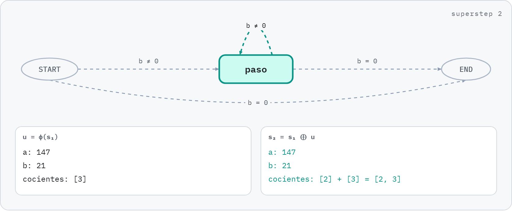

# Complementarios

Simulaciones interactivas del curso: las ideas que se entienden mejor viéndolas correr. Cada una sigue una lección, con la matemática y el código al lado, y su lógica está probada contra LangGraph.

**Para abrirlas:** [b3njjaman.github.io/LangGraph/complementarios](https://b3njjaman.github.io/LangGraph/complementarios/). Con el repositorio en el PC, también basta abrir `complementarios/index.html` en el navegador, sin servidor. GitHub muestra los archivos de esta carpeta, pero no ejecuta las páginas.

<a href="https://b3njjaman.github.io/LangGraph/complementarios/supersteps.html"><picture>
  <source media="(prefers-color-scheme: dark)" srcset="imagenes/supersteps-oscuro.png">
  
</picture></a>

| Simulación | Lección | Qué se ve |
|---|---|---|
| [Supersteps y reducers](https://b3njjaman.github.io/LangGraph/complementarios/supersteps.html) | 1 | Euclides y Newton un superstep a la vez: la actualización de cada nodo, el reducer y el corte de `recursion_limit` |
| add_messages<br><sub>próximamente</sub> | 2 | Por qué `a ⊕ b` y `b ⊕ a` no siempre coinciden |
| Temperatura y muestreo<br><sub>próximamente</sub> | 2 | `softmax(z/T)`, `top_k` y `top_p` sobre los mismos logits |
| El agente y sus checkpoints<br><sub>próximamente</sub> | 4 y 5 | El ciclo `modelo → tools`, un checkpoint por superstep y la vuelta atrás |

## Cómo está hecho

```
complementarios/
├── index.html, supersteps.html   las páginas
├── estilo.css, motor.js          lo común: paleta del curso, modo claro u oscuro, canvas, KaTeX
├── logica/                       la semántica de LangGraph en JavaScript, sin dibujo
├── escenas/                      el dibujo y los controles de cada página
├── paquetes/                     lo que carga el navegador: un script por página (generado)
└── pruebas/                      casos de LangGraph real y las pruebas de Node
```

`logica/`, `escenas/` y `motor.js` son módulos de JavaScript. Un navegador no carga módulos en una página abierta como archivo, así que cada página carga su paquete de `paquetes/`, armado desde esos módulos. Después de cambiar un módulo, desde la raíz:

```bash
node complementarios/empaquetar.mjs                 # rearma paquetes/
node --test "complementarios/pruebas/*.test.js"     # Node 22 o más nuevo
python complementarios/pruebas/generar_casos.py     # solo si cambian los casos; necesita langgraph
```

Las pruebas exigen tres cosas: que la lógica en JavaScript dé los mismos estados y errores que LangGraph en los casos generados, que el código mostrado en cada página esté tal cual en el archivo que cita y que los paquetes estén al día con sus módulos.
