# Módulo 1 · Introducción

Proyecto del módulo: un agente de cálculo simbólico. Parte como un grafo sin modelo de lenguaje y termina como un agente con memoria que deriva, integra y resuelve ecuaciones con SymPy.

Cada concepto se presenta como definición, propiedad y código, con diagramas animados del grafo y figuras de la matemática que hay detrás.



| Lección | Qué construye | Dónde corre |
|---|---|---|
| [1 · Grafo sin modelo](01_grafo_sin_modelo.ipynb) | Un algoritmo como grafo: el algoritmo de Euclides del código al diagrama de flujo y a LangGraph, y con él esquema, estado, nodo, reducer, aristas, supersteps y terminación. Después, el método de Newton con el mismo grafo. Con 11 diagramas (8 animados), 3 figuras y dos profundizaciones: Newton como método babilónico (la ecuación de Pell y la fracción continua de √2) y lo que ejecuta `compile` (Pregel y canales) | CPU |
| [2 · Mensajes y herramientas](02_mensajes_y_herramientas.ipynb) | Mensajes y conversaciones, `add_messages` como monoide idempotente no conmutativo, herramientas de SymPy y lo que el modelo ve de ellas, el modelo como núcleo de probabilidad y el grafo `START → modelo → END`. Con 2 diagramas animados y una profundización: un `tool_call` es texto (la plantilla y el lector de Ollama) | §1–4 en CPU, el resto en Kaggle |
| [3 · Router](03_router.ipynb) | El nodo de herramientas (`ToolNode`) y los tres modos en que falla un pedido, con `handle_tool_errors`; la arista `tools_condition`; el router y sus estados finales, probados con un modelo guionado: el modelo decide una vez y el grafo termina con el resultado de la herramienta. Con 2 diagramas animados y una profundización: los pedidos de un mensaje corren en hilos dentro de un superstep, y el GIL | §1–5 y la profundización en CPU, §6 en Kaggle |
| 4 · Agente *(próximamente)* | El ciclo `tools → modelo` y el límite de supersteps | Kaggle |
| 5 · Agente con memoria *(próximamente)* | El hilo como sucesión de estados, `get_state_history` | Kaggle |

**Simulación.** La lección 1 tiene una en el navegador: [Supersteps y reducers](https://b3njjaman.github.io/LangGraph/complementarios/supersteps.html), con Euclides y Newton un superstep a la vez. Las demás se irán sumando en [Complementarios](https://b3njjaman.github.io/LangGraph/complementarios/).

## Cómo ejecutar la lección 1

No necesita GPU ni claves. Desde la raíz del repositorio:

```bash
python -m venv .venv
.venv\Scripts\activate          # en macOS o Linux: source .venv/bin/activate
pip install -r modulos/requirements.txt
jupyter notebook
```

En el navegador, abrir `modulos/modulo-1/01_grafo_sin_modelo.ipynb`. Jupyter tiene que partir en la raíz del repositorio: las imágenes están en `imagenes/`, y si se abre directo en `modulos/modulo-1` no las puede servir.

El dibujo del grafo usa el servicio mermaid.ink, así que esa celda necesita internet. Las secciones 1 a 4 de la lección 2 también corren así.

## Cómo ejecutar las lecciones con modelo

Desde la lección 2, el modelo es `qwen3:8b` con [Ollama](https://ollama.com), en una GPU gratis de Kaggle:

1. En [kaggle.com](https://www.kaggle.com), **Create → New Notebook** y después **File → Import Notebook**, con la dirección del notebook en GitHub; por ejemplo, `https://github.com/B3njjaman/LangGraph/blob/main/modulos/modulo-1/02_mensajes_y_herramientas.ipynb`.
2. En **Settings**, **Accelerator → GPU T4 x2** e **Internet on**. Para activar internet, Kaggle pide verificar la cuenta con un teléfono.
3. **Run All**. La celda de preparación instala las dependencias y Ollama y descarga el modelo, en un minuto y medio; la primera llamada al modelo tarda cerca de dos minutos más, porque lo carga en la GPU.

El notebook importado no trae la carpeta `imagenes/`, así que en Kaggle no se ven los diagramas; se ven en GitHub. Con Ollama instalado y `ollama pull qwen3:8b` (unos 5 GB), el notebook también corre en un PC; fuera de Kaggle, la celda de preparación no hace nada.

## Imágenes

Los diagramas de flujo se escriben en [D2](https://d2lang.com) (fuentes en [`imagenes/diagramas/fuentes/modulo-1/`](../../imagenes/diagramas/fuentes/modulo-1/)) y las figuras se dibujan con [`imagenes/figuras/generar.py`](../../imagenes/figuras/generar.py), que solo usa la biblioteca estándar. Todos siguen el modo claro u oscuro del navegador. Para regenerarlos, desde la raíz:

```bash
python imagenes/diagramas/generar.py modulo-1    # necesita D2 0.9 o más nuevo
python imagenes/figuras/generar.py
```
